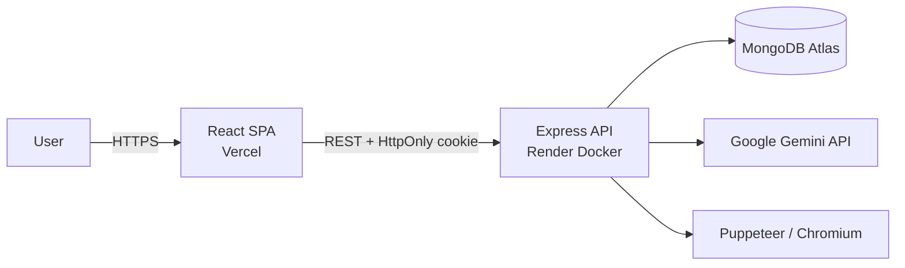

# SkillBridge

> Turn any job description into a personalized interview preparation plan with AI.

SkillBridge analyzes a job description alongside your resume or a short self-description, then generates a targeted match score, likely interview questions, skill-gap analysis, and a day-wise preparation roadmap. It can also generate a tailored, ATS-oriented resume PDF.

[](https://skillbridge-v31.vercel.app)
[](https://skillbridge-backend-7k2f.onrender.com/health)
[](https://react.dev)
[](https://nodejs.org)
[](https://www.mongodb.com/atlas)

- **Live application:** https://skillbridge-v31.vercel.app
- **Backend health check:** https://skillbridge-backend-7k2f.onrender.com/health
- **Repository:** https://github.com/Prince-Singh-Dev/SkillBridge

## Table of Contents

- [Overview](#overview)
- [Features](#features)
- [Tech Stack](#tech-stack)
- [Architecture](#architecture)
- [Project Structure](#project-structure)
- [Getting Started](#getting-started)
- [Environment Variables](#environment-variables)
- [API Reference](#api-reference)
- [How It Works](#how-it-works)
- [Security Notes](#security-notes)
- [Deployment](#deployment)
- [Known Limitations](#known-limitations)
- [Roadmap](#roadmap)
- [Contributing](#contributing)
- [Author](#author)

## Overview

Preparing for interviews usually means manually comparing your resume to a job description, guessing which questions will be asked, and building a study plan from scratch. SkillBridge automates that workflow in a single dashboard.

A user signs in, pastes a job description, optionally uploads a PDF resume or writes a short self-description, and receives a structured interview report. Reports are saved so they can be revisited later. A download button generates a resume PDF tailored to the same job.

## Features

### Interview preparation

- AI-generated interview report for any job description.
- Candidate-to-role match score with visual indicators.
- Technical questions with the interviewer's intention and a model answer for each.
- Behavioral questions with the same intention and answer guidance.
- Skill-gap analysis with `low`, `medium`, and `high` severity levels.
- Day-wise preparation roadmap with focused tasks.
- Resume upload (PDF, up to 5 MB) or a quick self-description as an alternative.
- Recent interview reports dashboard for revisiting previous plans.
- Tailored resume PDF download generated from the same role context.

### Accounts and security

- Email/password authentication with bcrypt password hashing.
- JWT session stored in an `HttpOnly` cookie.
- Server-side logout with a token blacklist and automatic TTL cleanup.
- Protected frontend routes and backend middleware.
- Per-user report ownership checks to prevent unauthorized access.
- Request validation, rate limiting, secure headers, and an explicit CORS allowlist.

### Engineering

- Shared Axios client with configurable API base URL and request de-duplication.
- PDF parsing for resume text extraction.
- Zod-validated AI responses before data is persisted.
- Timeouts and guaranteed browser cleanup for PDF generation.
- Docker image with Chromium for reliable server-side PDF rendering.
- SPA routing configured for Vercel and production CORS configured for Render.

## Tech Stack

| Layer | Technologies |
| --- | --- |
| Frontend | React 19, Vite 7, React Router 7, Axios, Sass, ESLint |
| Backend | Node.js 24, Express 5, MongoDB, Mongoose 9 |
| Authentication | JSON Web Tokens, bcryptjs, HttpOnly cookies |
| AI | Google Gemini via `@google/genai`, Zod, `zod-to-json-schema` |
| File processing | Multer (memory storage), pdf-parse, Puppeteer |
| Security | Helmet, CORS, express-rate-limit, Zod validation |
| Deployment | Vercel (frontend), Render (Docker backend), MongoDB Atlas, UptimeRobot |

## Architecture



The frontend is a React single-page application. The backend exposes a REST API, stores users and reports in MongoDB Atlas, calls Gemini for structured generation, and uses headless Chromium to render resume PDFs.

## Project Structure

```text
SkillBridge/
├── Backend/
│   ├── src/
│   │   ├── config/          # MongoDB connection
│   │   ├── controllers/     # Auth and interview request handlers
│   │   ├── middlewares/     # Auth, uploads, validation, errors, rate limits
│   │   ├── models/          # User, interview report, token blacklist
│   │   ├── routes/          # Express route definitions
│   │   ├── services/        # Gemini and PDF generation logic
│   │   └── validators/      # Zod request schemas
│   ├── .env.example
│   ├── .dockerignore
│   ├── Dockerfile
│   ├── package.json
│   └── server.js
├── Frontend/
│   ├── src/
│   │   ├── components/      # Shared UI components
│   │   ├── features/
│   │   │   ├── auth/        # Auth context, hooks, pages, API
│   │   │   └── interview/   # Interview context, pages, styles, API
│   │   ├── lib/             # Shared Axios client
│   │   ├── style/           # Shared styles
│   │   ├── App.jsx
│   │   ├── app.routes.jsx
│   │   └── main.jsx
│   ├── .env.example
│   ├── package.json
│   ├── vercel.json
│   └── vite.config.js
└── README.md
```

## Getting Started

### Prerequisites

- Node.js 20 or newer (the Docker image uses Node 24).
- npm.
- A MongoDB database (MongoDB Atlas or a local instance).
- A Google Gemini API key from [Google AI Studio](https://aistudio.google.com/app/apikey).
- Chromium system libraries for local PDF generation on Linux (or use Docker).

### 1. Clone the repository

```bash
git clone https://github.com/Prince-Singh-Dev/SkillBridge.git
cd SkillBridge
```

### 2. Start the backend

```bash
cd Backend
npm install
cp .env.example .env
```

Fill in `.env`, then start the API:

```bash
npm run dev
```

The backend runs at `http://localhost:3000`. Verify it with:

```bash
curl http://localhost:3000/health
```

You should receive:

```json
{ "status": "ok" }
```

### 3. Start the frontend

In a second terminal:

```bash
cd Frontend
npm install
cp .env.example .env
npm run dev
```

Open `http://localhost:5173`.

### Optional: Run the backend with Docker

The provided image installs Chromium and its runtime dependencies:

```bash
docker build -t skillbridge-api ./Backend
docker run --rm --env-file Backend/.env -p 3000:3000 skillbridge-api
```

## Environment Variables

### Backend (`Backend/.env`)

| Variable | Required | Description |
| --- | --- | --- |
| `MONGO_URI` | Yes | MongoDB Atlas or local connection string. |
| `JWT_SECRET` | Yes | Long random secret used to sign session tokens. |
| `GOOGLE_GENAI_API_KEY` | Yes | Gemini API key used for report and resume generation. |
| `PORT` | No | API port. Defaults to `3000`; Render injects its own value. |
| `CLIENT_URL` | No | Allowed frontend origin. Comma-separate multiple origins. Defaults to `http://localhost:5173`. |
| `NODE_ENV` | No | Set to `production` in production for secure cross-site cookies and proxy trust. |

### Frontend (`Frontend/.env`)

| Variable | Required | Description |
| --- | --- | --- |
| `VITE_API_URL` | Yes in deployment | Backend base URL. Defaults to `http://localhost:3000` in code. |

For local development, the defaults work without editing the frontend environment file.

## API Reference

Base URL: `http://localhost:3000` (local) or your deployed backend URL.

Authentication uses an `HttpOnly` cookie named `token`. Browser requests must be sent with credentials enabled.

| Method | Endpoint | Access | Description |
| --- | --- | --- | --- |
| `POST` | `/api/auth/register` | Public | Create an account with username, email, and password. |
| `POST` | `/api/auth/login` | Public | Authenticate and set the session cookie. |
| `POST` | `/api/auth/logout` | Public | Clear the cookie and blacklist the current token. |
| `GET` | `/api/auth/get-me` | Private | Return the authenticated user. |
| `POST` | `/api/interview/` | Private | Generate and save an interview report. |
| `GET` | `/api/interview/` | Private | List the current user's interview reports. |
| `GET` | `/api/interview/report/:interviewId` | Private | Fetch a single report. |
| `POST` | `/api/interview/resume/pdf/:interviewReportId` | Private | Generate and download a tailored resume PDF. |
| `GET` | `/health` | Public | Liveness probe used by Render and UptimeRobot. |

### Generate report request

`POST /api/interview/` expects `multipart/form-data`:

| Field | Type | Rules |
| --- | --- | --- |
| `jobDescription` | Text | Required, 20 to 5000 characters. |
| `selfDescription` | Text | Optional, up to 2000 characters. |
| `resume` | File | Optional PDF, maximum 5 MB. |

At least one of `selfDescription` or `resume` must be provided.

## How It Works

1. The user registers or logs in. The backend signs a 1-day JWT and stores it in an `HttpOnly` cookie.
2. The user submits a job description and either a PDF resume, a self-description, or both.
3. If a resume is provided, its text is extracted server-side with `pdf-parse`.
4. Gemini receives the combined context with a JSON schema and returns a structured report.
5. The response is validated with Zod and saved to MongoDB under the authenticated user.
6. The frontend renders the match score, questions, skill gaps, and roadmap in the report dashboard.
7. When the user downloads a resume PDF, Gemini generates tailored HTML, and Puppeteer renders it to A4 PDF in Chromium.

## Security Notes

- Passwords are hashed with bcrypt using 12 rounds; password length is capped at 72 characters.
- Session tokens expire after 1 day and are stored in `HttpOnly` cookies.
- Cookies use `SameSite=Lax` in development and `SameSite=None; Secure` in production for cross-site deployment.
- Logout adds the token to a MongoDB blacklist with a TTL index, so entries are removed automatically.
- Zod schemas validate request bodies and AI output. Text fields have explicit maximum lengths.
- Uploads accept only PDF files (MIME type and extension), with a 5 MB size limit and a single-file limit.
- Report reads and PDF generation are scoped to the authenticated user to prevent IDOR.
- Auth endpoints are limited to 20 failed attempts per 15 minutes; interview generation is limited to 20 requests per hour.
- Helmet sets security headers, CORS uses an explicit origin allowlist, and JSON bodies are capped at 1 MB.
- Puppeteer pages are rendered with JavaScript disabled and container-appropriate sandbox flags.
- Real `.env` files are git-ignored. Secrets are provided at runtime through environment variables.

## Deployment

The project is deployed as two services:

### Backend on Render

- Runtime: **Docker**.
- Root Directory: `Backend`.
- Dockerfile Path: `Dockerfile`.
- Health Check Path: `/health`.
- Environment variables: `NODE_ENV=production`, `MONGO_URI`, `JWT_SECRET`, `GOOGLE_GENAI_API_KEY`, and `CLIENT_URL`.
- Do not set `PORT`; Render injects it.
- The Docker image installs Chromium and runs the API as a non-root user.

### Frontend on Vercel

- Root Directory: `Frontend`.
- Framework Preset: **Vite**.
- Build Command: `npm run build`.
- Output Directory: `dist`.
- Environment variable: `VITE_API_URL` set to the Render service URL.
- `vercel.json` contains the SPA rewrite so client-side routes work on refresh.

### Keep-alive and database access

- Render free web services sleep after inactivity. UptimeRobot requests `/health` every 10 minutes to keep the API awake.
- MongoDB Atlas must allow connections from Render. On the free tier, Render uses dynamic outbound IPs, so Atlas network access typically needs `0.0.0.0/0` with a strong, least-privilege database user.
- If the frontend domain changes, update `CLIENT_URL` on Render and redeploy.

### Deployment checklist

- [ ] Backend `.env` values configured on Render.
- [ ] `NODE_ENV=production` set on Render.
- [ ] `CLIENT_URL` matches the production frontend origin.
- [ ] `VITE_API_URL` on Vercel matches the backend URL.
- [ ] MongoDB Atlas network access allows the backend.
- [ ] `/health` returns `200`.
- [ ] UptimeRobot monitor is active.
- [ ] Register, login, report generation, and PDF download tested in production.

## Known Limitations

- The deployed frontend and API use different domains, so the auth cookie is third-party. Chrome supports this setup, but browsers that block third-party cookies (notably Safari and some Firefox configurations) may prevent login. A custom API subdomain on the same site or a same-origin reverse proxy would resolve this.
- Render's free tier provides 512 MB of RAM and can cold-start after redeploys. Chromium PDF rendering is heavier than normal API requests.
- AI generation depends on Gemini availability, quotas, and response quality.
- Automated tests and CI checks are not yet configured.
- The interface is desktop-first; smaller screens need layout work.

## Roadmap

- Add backend integration tests and Playwright end-to-end tests.
- Add GitHub Actions for linting, build verification, and deployment checks.
- Move AI and PDF generation to a background queue for long-running jobs.
- Support multiple resume templates and PDF styling options.
- Add password reset, email verification, and OAuth sign-in.
- Improve mobile and tablet layouts.
- Add streaming AI responses for faster perceived generation.

## Contributing

Contributions are welcome:

1. Fork the repository.
2. Create a feature branch: `git checkout -b feature/your-feature`.
3. Make your changes and run the frontend build and lint commands.
4. Commit with a clear message and open a pull request.

Please do not commit real `.env` files or API keys.

## Author

**Prince Singh**

- GitHub: [@Prince-Singh-Dev](https://github.com/Prince-Singh-Dev)
- Live project: [skillbridge-v31.vercel.app](https://skillbridge-v31.vercel.app)
